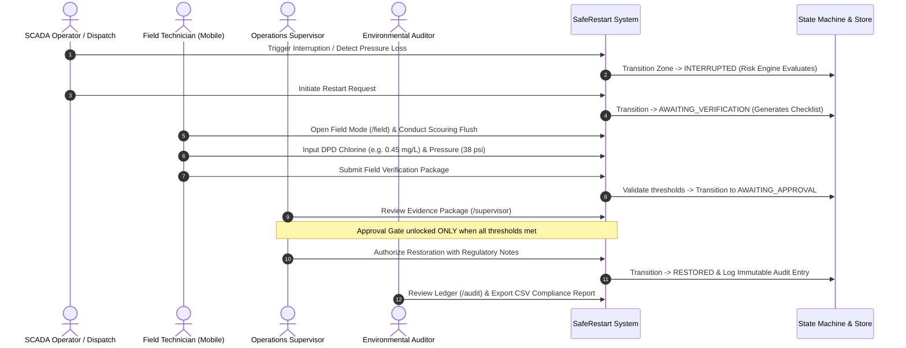
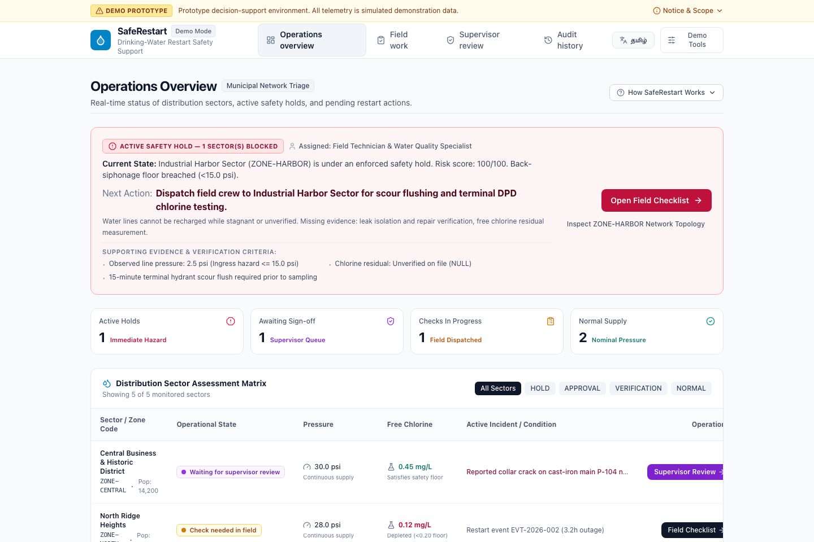
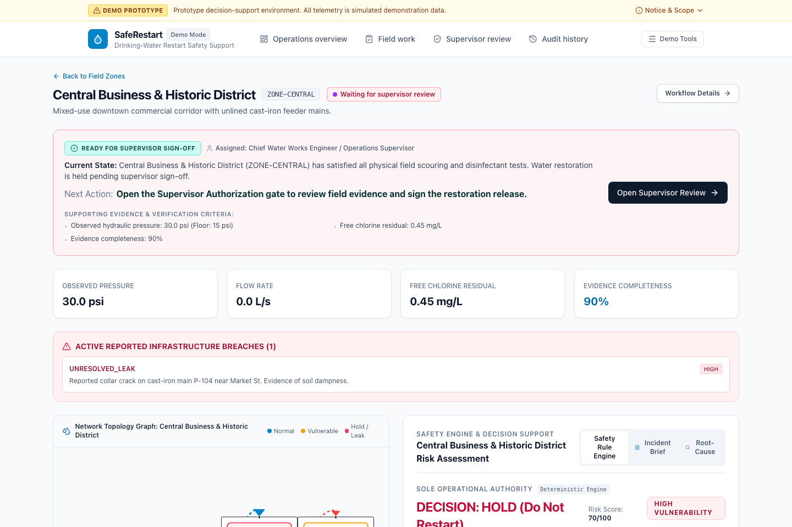
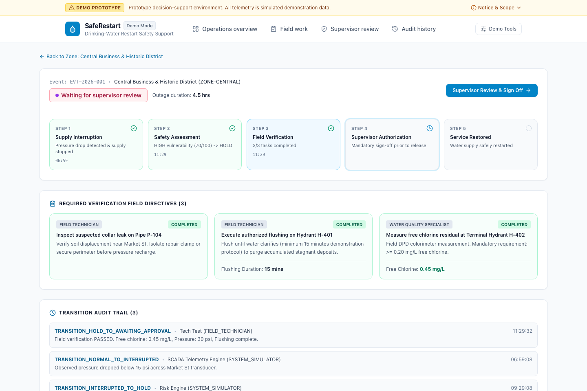
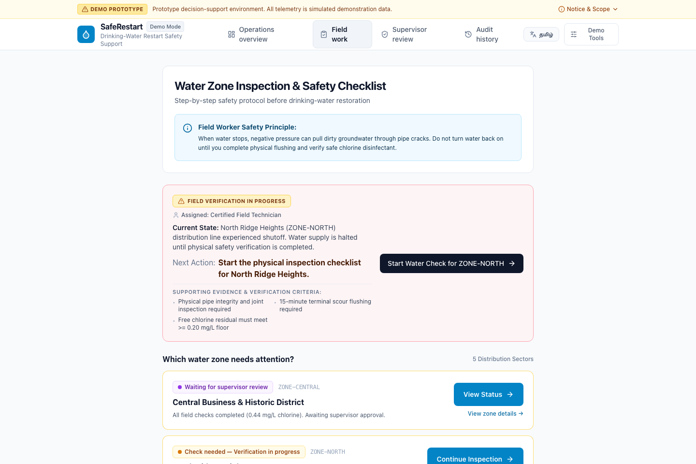
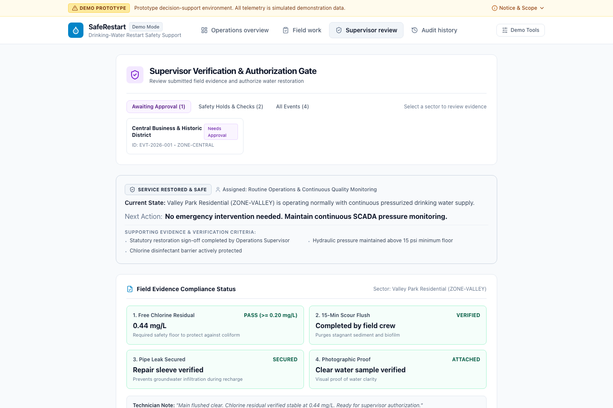
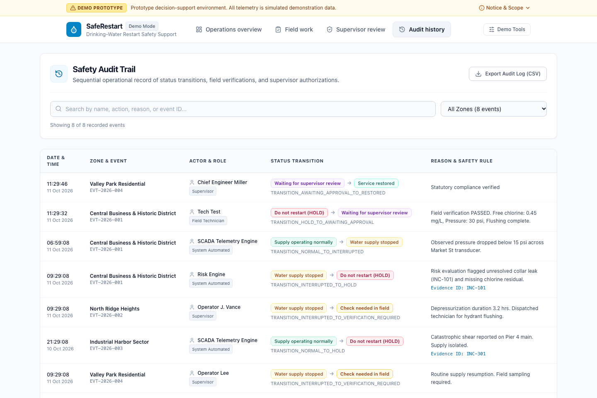
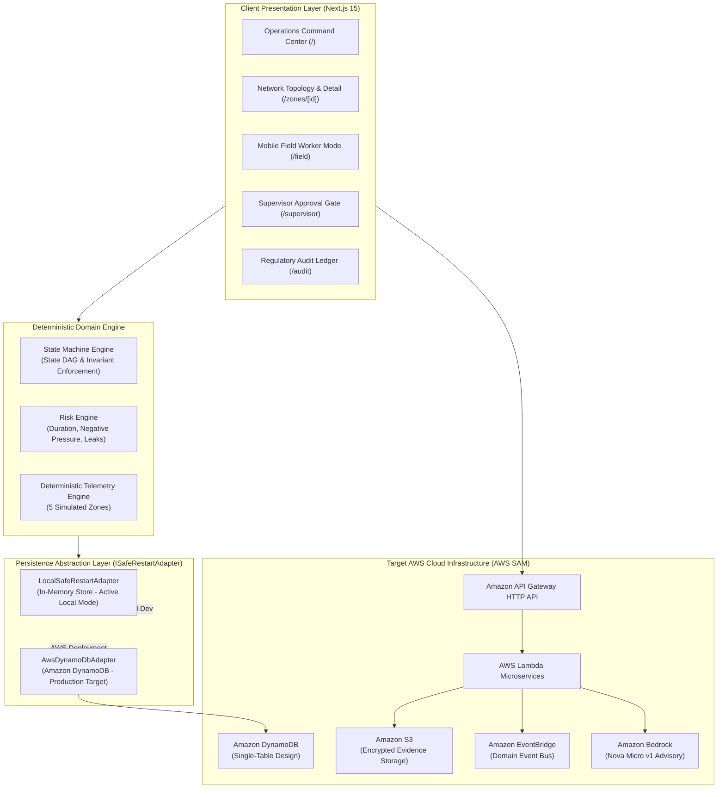
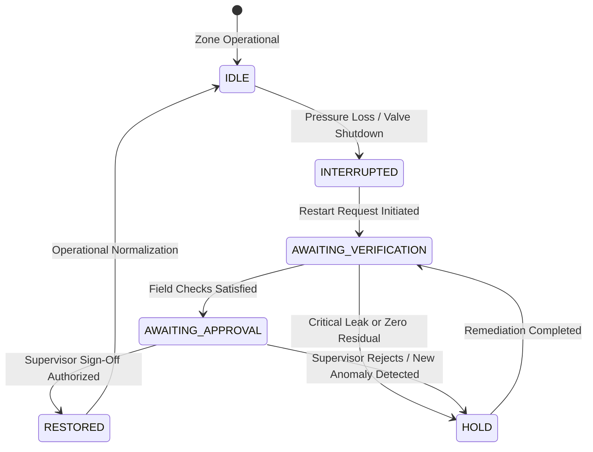

# SafeRestart

> **Field-first decision support for safer drinking-water network restarts.**  
> *Built for the WeMakeDevs × AWS Environmental Hacks Hackathon*

---

> [!CAUTION]
> ### SAFETY & REGULATORY DISCLAIMER
> **SafeRestart is an operational decision-support prototype built for demonstration, engineering evaluation, and hackathon presentation.**  
> It does **not** certify drinking-water microbiological or chemical safety, nor does it replace statutory municipal water utility standard operating procedures, certified laboratory testing, or statutory public health regulations. All sensor streams, pressure curves, water-quality values, and risk scores within this repository are deterministic simulated demonstration data. Actual water-supply restoration requires physical field testing, certified laboratory confirmation, and explicit authorization by licensed municipal waterworks engineers.

---

## Table of Contents

- [1. Problem Statement](#1-problem-statement)
- [2. The SafeRestart Solution](#2-the-saferestart-solution)
- [3. Key Features: Implemented vs. Planned](#3-key-features-implemented-vs-planned)
- [4. Operational Workflow & User Journey](#4-operational-workflow--user-journey)
- [5. Application Walkthrough & Visual Tour](#5-application-walkthrough--visual-tour)
- [6. Architecture & System Design](#6-architecture--system-design)
- [7. Technology Stack](#7-technology-stack)
- [8. Installation & Local Development](#8-installation--local-development)
- [9. Configuration & Environment Variables](#9-configuration--environment-variables)
- [10. Testing, Quality & Build Verification](#10-testing-quality--build-verification)
- [11. 3-Minute Demonstration Script](#11-3-minute-demonstration-script)
- [12. AWS Architecture & Integration Status](#12-aws-architecture--integration-status)
- [13. Data Handling, Simulation Mode & Boundaries](#13-data-handling-simulation-mode--boundaries)
- [14. AI Usage Disclosure](#14-ai-usage-disclosure)
- [15. Roadmap & Future Improvements](#15-roadmap--future-improvements)
- [16. Acknowledgements & References](#16-acknowledgements--references)

---

## 1. Problem Statement

Over **one billion people** globally rely on **intermittent water supply (IWS)** networks—distribution systems that alternate between pressurized supply cycles and unpressurized shutdown periods. When an intermittent drinking-water distribution zone experiences an unplanned or prolonged interruption, pipe pressure collapses to zero or sub-atmospheric (negative) levels.

Depressurization triggers severe physical and environmental hazards:

1. **Back-Siphonage & External Contaminant Intrusion**: Negative hydraulic pressure aspirates contaminated groundwater, sewage from proximate lateral trenches, and soil pathogens through cracked pipes, deteriorated gaskets, and unsealed joints.
2. **Biofilm Shearing & Tuberculation Release**: When dry or stagnant pipes are abruptly repressurized, hydraulic transients (water hammer) scour stagnant biofilm and dislodge heavy-metal tuberculation from interior pipe walls.
3. **Disinfectant Decay**: In stagnant distribution mains, free chlorine residual decays rapidly due to organic matter oxidation, eliminating the protective disinfectant barrier.
4. **Operational Blind Spots & Fragmented Communication**: Traditional SCADA systems display telemetry alarms but fail to guide field crews. SCADA operators, field technicians flushing hydrants, and municipal supervisors authorizing release communicate via disconnected phone calls, paper clipboards, and memory. Restorations often occur without verified flushing or certified chlorine residuals.

SafeRestart does not claim to invent water sensors, hydraulic transient models, or lab testing. **SafeRestart solves the operational workflow gap**: bridging SCADA telemetry, physical field validation, and accountable supervisor authorization into a single, transparent audit-logged workflow.

---

## 2. The SafeRestart Solution

SafeRestart transforms uncoordinated water network restarts into a structured, gated, and auditable operational lifecycle:

```
INTERRUPTION ➔ ASSESSMENT ➔ HOLD / REQUIRE VERIFICATION ➔ FIELD VERIFICATION ➔ SUPERVISOR APPROVAL ➔ RESTORATION ➔ REGULATORY AUDIT TRAIL
```

SafeRestart answers the **6 essential operational questions** every water utility faces before opening a valve:

1. **What happened to this water-supply zone?** (Interruption duration, minimum observed pressure, depressurization extent, impacted population).
2. **What evidence is available?** (SCADA pressure time series, supply flow rates, last recorded chlorine residual).
3. **What risk factors require immediate attention?** (Aged unlined cast-iron mains, unisolated collar leaks, pressure transients, stale telemetry).
4. **What must the field worker do next?** (Mobile-first tasks: pipe leak inspection, scouring hydrant flush, DPD colorimeter chlorine sampling).
5. **Have the configured safety criteria been satisfied?** (Enforces strict thresholds: Free Chlorine $\ge 0.20\text{ mg/L}$, Pressure $\ge 20.0\text{ psi}$, Turbidity $\le 1.0\text{ NTU}$).
6. **Who authorized service restoration, and what evidence supports it?** (Attributable supervisor sign-off recorded in an immutable, exportable regulatory audit ledger).

---

## 3. Key Features: Implemented vs. Planned

| Capability / Module | Status | Implementation Details |
| :--- | :--- | :--- |
| **Deterministic Simulation Engine** | **Implemented** | 5 distinct distribution zones with distinct topology, elevation profiles, pipe age, and synthetic telemetry generators. |
| **Interactive Network Topology Map** | **Implemented** | React Flow (`@xyflow/react`) canvas rendering reservoirs, PRVs, pipe segments, junctions, and hydrant sampling taps. |
| **Deterministic Risk Engine** | **Implemented** | Multi-factor rule-based heuristics evaluating interruption duration, negative pressure ingress, and active pipe leaks without black-box opacity. |
| **State Machine Lifecycle** | **Implemented** | Strict state machine DAG preventing unauthorized state transitions (`IDLE` $\rightarrow$ `INTERRUPTED` $\rightarrow$ `AWAITING_VERIFICATION` $\rightarrow$ `AWAITING_APPROVAL` $\rightarrow$ `RESTORED`). |
| **Field Technician Checklist** | **Implemented** | Mobile-optimized interface for field workers to record DPD chlorine, digital pressure, scouring flush duration, and photo verification. |
| **Supervisor Authorization Gate** | **Implemented** | Hard-locked sign-off barrier requiring satisfied field evidence, non-empty sign-off comments, and supervisor attribution. |
| **Regulatory Audit Ledger** | **Implemented** | Complete event trail tracking actor identity, previous state, new state, timestamp, and one-click CSV export. |
| **Bedrock AI Advisory Synthesis** | **Implemented** | Amazon Bedrock (`amazon.nova-micro-v1:0` in `ap-southeast-2`) integration with deterministic offline heuristics fallback for natural-language explanations and field note structuring. |
| **Decoupled Persistence Architecture** | **Implemented** | Clean `ISafeRestartAdapter` interface with fully operational `LocalSafeRestartAdapter` (zero-credential local dev) and AWS DynamoDB data adapter. |
| **Infrastructure-as-Code (IaC)** | **Implemented** | Production-ready AWS SAM specification ([`template.yaml`](file:///Users/bharathadithya/.gemini/antigravity/scratch/saferestart/template.yaml)) defining API Gateway, Lambda, DynamoDB, S3, and EventBridge. |
| *EPANET 2.2 Hydraulic Engine WASM* | *Planned* | Compiling the EPA EPANET hydraulic solver to WebAssembly for client-side water-age and hydraulic transient calculation. |
| *LoRaWAN Edge Gateway Ingestion* | *Planned* | Direct binary payload parser for physical pressure sensors and cellular telemetry units. |
| *Offline PWA Field Sync* | *Planned* | ServiceWorker IndexedDB queueing for field technicians operating in basement or subterranean vaults without cellular coverage. |
| *Multi-Utility Multi-Tenant Federation* | *Planned* | AWS Cognito user pools with RBAC tenancy for regional water boards managing multiple autonomous municipal districts. |

---

## 4. Operational Workflow & User Journey

SafeRestart supports 4 primary operational roles:



1. **SCADA Dispatcher** (`/`): Observes live pressure drop or valve failure in Zone 1. Initiates restart assessment. The system evaluates network age and active leaks, placing the zone on **HOLD**.
2. **Field Technician** (`/field`): Receives automated directives on their mobile device: repair collar leak on `Z1-P-104`, conduct 15-minute scouring flush at terminal hydrant `Z1-HYD-01`, and record DPD colorimeter chlorine sample.
3. **Operations Supervisor** (`/supervisor`): Reviews submitted photo proof, field timestamps, and chemical values. The gated sign-off button remains disabled until all demonstration thresholds ($\ge 0.20\text{ mg/L}$ free chlorine, $\ge 20\text{ psi}$) are verified. Authorizes water service restoration.
4. **Compliance Auditor** (`/audit`): Inspects the chronological transition ledger, verifies actor attribution (`marcus.vance@utility.gov`), and exports the audit record for regulatory reporting.

---

## 5. Application Walkthrough & Visual Tour

> Placeholder images below reference assets in [`docs/screenshots/`](file:///Users/bharathadithya/.gemini/antigravity/scratch/saferestart/docs/screenshots/). Replace them with actual screenshots of your running instance.

### 1. Operations Command Center
The central command dashboard provides an overview of all 5 municipal water-supply zones, aggregate restart holds, evidence completeness progress bars, and simulation controls.


*Figure 1: Operations Command Center (`/`) showing zone grid, pressure indicators, and demonstration controls.*

### 2. Interactive Water Network Topology
Built with React Flow, this view allows engineers to inspect reservoirs, control valves, junctions, pipe age, and terminal sampling hydrants.


*Figure 2: Zone Detail View (`/zones/zone-1`) featuring interactive hydraulic node graph and real-time pressure time series.*

### 3. Deterministic Risk Evaluation & AI Advisory
Transparent risk breakdown highlighting interruption duration, negative-pressure ingress hazards, and active pipe leaks with Amazon Bedrock operator explanations.


*Figure 3: Deterministic risk engine score card and Amazon Bedrock advisory synthesis.*

### 4. Mobile Field Worker Verification
Step-by-step mobile checklist designed for utility crews in the field to log chlorine measurements, flush hydrants, and upload photo proof.


*Figure 4: Mobile Field Worker Mode (`/field`) with judge presets for passing and failing field scenarios.*

### 5. Supervisor Authorization Gate
Gated sign-off interface that locks out service restoration until all configured physical criteria are met.


*Figure 5: Supervisor Review Gate (`/supervisor`) displaying compliance checks, signature input, and release controls.*

### 6. Regulatory Audit Trail
Filterable, searchable compliance ledger with full actor attribution and CSV export.


*Figure 6: Immutable Regulatory Audit Trail (`/audit`) with transition logs and CSV export.*

---

## 6. Architecture & System Design

SafeRestart follows a modular, decoupled architecture where business logic is strictly separated from infrastructure adapters.

### High-Level System Architecture



### State Machine Lifecycle DAG

SafeRestart enforces a strict state machine preventing invalid shortcuts:



Detailed architectural specifications, data schemas, and mathematical heuristics are documented in [`docs/ARCHITECTURE.md`](file:///Users/bharathadithya/.gemini/antigravity/scratch/saferestart/docs/ARCHITECTURE.md).

---

## 7. Technology Stack

| Layer | Technology | Version | Purpose in SafeRestart |
| :--- | :--- | :--- | :--- |
| **Framework** | Next.js (App Router) | 15.2.1 | Unified full-stack framework for server-rendered UI and REST API routes. |
| **Language** | TypeScript | 5.8+ | Strict type safety with zero runtime surprises; strict mode enabled. |
| **UI Library** | React | 19.0.0 | Component rendering, hooks, and responsive state synchronization. |
| **Styling** | Tailwind CSS | 3.4.17 | Accessible light civic public-works system (`slate-50`, `#f8fafc`). |
| **Network Topology** | React Flow (`@xyflow/react`) | 12.4.4 | Interactive hydraulic schematic displaying reservoirs, pipes, valves, and junctions. |
| **Hydraulic Charts** | Recharts | 2.15.1 | Responsive time-series charts rendering pressure curves and chlorine depletion. |
| **Icons** | Lucide React | 0.477.0 | Consistent iconography for hydraulic assets, status badges, and warnings. |
| **Unit & Integration Tests**| Vitest | 3.0.7 | Fast unit and integration test runner for state machines and risk heuristics. |
| **Cloud IaC** | AWS SAM | Specification | Infrastructure-as-code template defining AWS cloud services. |
| **Database (Production)** | Amazon DynamoDB | Cloud Target | Serverless single-table persistence with pay-per-request billing. |
| **Event Bus (Production)**| Amazon EventBridge | Cloud Target | Asynchronous decoupling for interruption events and audit logging. |
| **Object Store (Production)**| Amazon S3 | Cloud Target | Server-side encrypted storage for field verification photo evidence. |
| **Generative AI** | Amazon Bedrock | Cloud Target | Operator advisory summaries & note structuring via `amazon.nova-micro-v1:0` (`ap-southeast-2`). |

---

## 8. Installation & Local Development

### Prerequisites

- **Node.js**: v20.x or v22.x LTS (v24+ also supported)
- **npm**: v10+
- **Git**: v2.30+

### Step-by-Step Setup

1. **Clone the repository**:
   ```bash
   git clone https://github.com/Bharathadi01/saferestart.git
   cd saferestart
   ```

2. **Install dependencies**:
   ```bash
   npm install
   ```

3. **Configure environment variables**:
   ```bash
   cp .env.example .env.local
   ```
   *Note: No AWS credentials are required for local development. The project runs out-of-the-box using the deterministic in-memory persistence adapter.*

4. **Start the local development server**:
   ```bash
   npm run dev
   ```

5. **Open in browser**:
   Navigate to [http://localhost:3000](http://localhost:3000) to access the Operations Command Center.

---

## 9. Configuration & Environment Variables

All environment variables have safe fallback defaults for local execution. See [`.env.example`](file:///Users/bharathadithya/.gemini/antigravity/scratch/saferestart/.env.example):

```ini
# Node Environment
NODE_ENV=development

# AWS Region (Defaults to ap-southeast-2 Sydney, matching verified Bedrock playground)
AWS_REGION=ap-southeast-2

# Amazon Bedrock Model Configuration (Defaults to amazon.nova-micro-v1:0)
BEDROCK_MODEL_ID=amazon.nova-micro-v1:0

# Production AWS IAM Role / Default Credential Provider Chain
# In AWS Amplify Hosting or ECS/Lambda, role-based SigV4 auth is automatically discovered.
# Static keys or bearer tokens are NOT required in production.
# AWS_USE_IAM_ROLE=true

# AWS Authentication (Option 1: Short-term Bedrock API Key bearer token - Local dev testing)
# AWS_BEARER_TOKEN_BEDROCK=ey...

# AWS Authentication (Option 2: Standard IAM Credentials - Local dev alternative)
# AWS_ACCESS_KEY_ID=
# AWS_SECRET_ACCESS_KEY=
# AWS_SESSION_TOKEN=

# Storage & Persistence (Defaults to false / in-memory until real tables are provisioned)
USE_DYNAMODB=false
# ZONES_TABLE=saferestart-zones-dev
# RESTART_EVENTS_TABLE=saferestart-events-dev
# AUDIT_TRAIL_TABLE=saferestart-audit-dev

# Amazon S3 Field Evidence Bucket
# EVIDENCE_BUCKET=saferestart-evidence-dev

# Amazon EventBridge Custom Event Bus
# EVENT_BUS_NAME=saferestart-bus-dev
```

When AWS credentials are omitted, SafeRestart automatically routes data through `LocalSafeRestartAdapter`, maintaining complete statefulness in memory without cloud dependencies or billing.

---

## 10. Testing, Quality & Build Verification

SafeRestart adheres to strict engineering quality standards. Five verification commands are available:

```bash
# 1. Run ESLint (must pass with 0 warnings and 0 errors)
npm run lint

# 2. Strict TypeScript type check (noEmit)
npm run typecheck

# 3. Unit and integration tests with Vitest (64/64 passing across 6 suites)
npm test

# 4. Standalone live AWS Bedrock integration diagnostic
npm run verify:aws

# 5. Production Next.js build compilation
npm run build
```

### Test Coverage Highlights

- `tests/unit/risk-engine.test.ts`: Verifies mathematical boundary conditions, negative-pressure ingress penalties, aged cast-iron risk factors, and missing telemetry deductions.
- `tests/unit/state-machine.test.ts`: Enforces state transition invariants, preventing restarts without prior field verification or unassigned supervisor sign-offs.
- `tests/unit/adapters.test.ts`: Validates persistence contract adherence between local in-memory stores and cloud interfaces.
- `tests/integration/simulation-workflow.test.ts`: Executes the complete end-to-end lifecycle from interruption to restoration across multiple synthetic zones.
- `tests/aws-integration.test.ts`: 21 comprehensive integration and safety invariant tests verifying:
  - AWS SDK default credential provider chain for Amplify SSR compute IAM execution roles (SigV4).
  - Bedrock SDK bearer-token auth (`httpBearerAuth`) for local development.
  - Converse API payload formatting for `amazon.nova-micro-v1:0` in `ap-southeast-2`.
  - Graceful deterministic offline fallback upon `AccessDeniedException` or network timeout.
  - Strict safety guarantees that AI explanations never override deterministic safety engine `HOLD` decisions.
- `tests/copilot.test.ts`: Validates field report structuring, operator guidance, prompt injection sanitization, and fallback behavior.

For detailed testing documentation, see [`docs/TESTING.md`](file:///Users/bharathadithya/.gemini/antigravity/scratch/saferestart/docs/TESTING.md).

---

## 11. 3-Minute Demonstration Script

For hackathon judges and evaluators, a deterministic 3-minute walkthrough script is provided in [`docs/DEMO_SCRIPT.md`](file:///Users/bharathadithya/.gemini/antigravity/scratch/saferestart/docs/DEMO_SCRIPT.md).

### Summary Walkthrough

1. **Command Center (`/`)**:
   - Observe the prominent banner: `DEMO MODE — SIMULATED NETWORK DATA`.
   - Inspect **Zone 1 (Central Business)** on **HOLD** due to an active leak on pipe `Z1-P-104` and missing chlorine data.
   - Inspect **Zone 4 (Valley Park)** in **Awaiting Approval** state.
2. **Network Topology (`/zones/zone-1`)**:
   - Inspect the interactive React Flow network topology.
   - Click node `Z1-JNC-01` to view node pressure and elevation in the inspection drawer.
   - Review the dashed red pipe `Z1-P-104` marked `LEAK SUSPECTED`.
   - View the Risk Engine card showing `ACTION: HOLD` and missing evidence requirements.
   - Click **Explain Decision with AI** to view Bedrock advisory synthesis.
3. **Field Technician Verification (`/field`)**:
   - Select `Central Business & Historic District`.
   - Click judge quick preset: **Load Passing Sample (0.45 mg/L)**.
   - Click **Submit Evidence for Supervisor Review**.
4. **Supervisor Approval Gate (`/supervisor`)**:
   - Select the updated restart request.
   - Observe that the Approval Gate is unlocked with green passing badges for chlorine, pressure, and flushing.
   - Check the compliance confirmation box and click **Authorize Drinking Water Service Restoration**.
5. **Regulatory Audit Trail (`/audit`)**:
   - View the newly committed `TRANSITION_AWAITING_APPROVAL_TO_RESTORED` record with actor name and timestamp.
   - Click **Export Audit Trail (CSV)** to download compliance documentation.

---

## 12. AWS Architecture & Integration Status

SafeRestart is architected following cloud-native, serverless AWS best practices. We maintain transparent disclosure of what is implemented locally versus the AWS deployment blueprint:

| AWS Service | Architectural Role | Implementation Status | Verification Artifact |
| :--- | :--- | :--- | :--- |
| **Amazon API Gateway** | HTTP API frontend routing REST requests to serverless backends | **IaC Specified** (AWS SAM) | [`template.yaml`](file:///Users/bharathadithya/.gemini/antigravity/scratch/saferestart/template.yaml) |
| **AWS Lambda** | Stateless compute for risk engine, event processing, and audit recording | **IaC Specified** (AWS SAM) | [`template.yaml`](file:///Users/bharathadithya/.gemini/antigravity/scratch/saferestart/template.yaml) |
| **Amazon DynamoDB** | Single-table persistence for zones, restart events, and immutable audit logs | **Active in Local Adapter** / **IaC Specified** | [`src/lib/adapters/`](file:///Users/bharathadithya/.gemini/antigravity/scratch/saferestart/src/lib/adapters/), [`template.yaml`](file:///Users/bharathadithya/.gemini/antigravity/scratch/saferestart/template.yaml) |
| **Amazon S3** | Encrypted object storage for field verification photo evidence | **IaC Specified** (AWS SAM) | [`template.yaml`](file:///Users/bharathadithya/.gemini/antigravity/scratch/saferestart/template.yaml) |
| **Amazon EventBridge** | Custom domain event bus for asynchronous interruption orchestration | **IaC Specified** (AWS SAM) | [`template.yaml`](file:///Users/bharathadithya/.gemini/antigravity/scratch/saferestart/template.yaml) |
| **Amazon Bedrock** | GenAI advisory synthesis & note structuring powered by `amazon.nova-micro-v1:0` (`ap-southeast-2`) | **Implemented** (SDK Route with deterministic offline fallback and live verification) | [`src/lib/aws-client.ts`](file:///Users/bharathadithya/.gemini/antigravity/scratch/saferestart/src/lib/aws-client.ts), [`src/app/api/bedrock/explain/route.ts`](file:///Users/bharathadithya/.gemini/antigravity/scratch/saferestart/src/app/api/bedrock/explain/route.ts) |
| **AWS IAM** | Least-privilege role policies for execution boundaries | **IaC Specified** (AWS SAM) | [`template.yaml`](file:///Users/bharathadithya/.gemini/antigravity/scratch/saferestart/template.yaml) |

### Deploying to AWS via SAM

When ready for AWS cloud deployment:

```bash
# 1. Validate the SAM template
sam validate

# 2. Build the serverless application
sam build

# 3. Guided deployment to your AWS account
sam deploy --guided
```

This provisions:
- `SafeRestartHttpApi`: Amazon API Gateway HTTP API
- `ZonesTable`, `RestartEventsTable`, `AuditTrailTable`: Pay-per-request DynamoDB tables with Point-in-Time Recovery and SSE enabled
- `EvidenceBucket`: Amazon S3 bucket with public access blocked and AES-256 SSE
- `SafeRestartEventBus`: Amazon EventBridge event bus
- Least-privilege IAM execution roles for each handler

---

## 13. Data Handling, Simulation Mode & Boundaries

SafeRestart includes a deterministic synthetic telemetry generator modeling **5 realistic water-distribution zones**:

1. **Zone 1: Central Business & Historic District** (Aged unlined cast iron, high connectivity, active collar leak on pipe `Z1-P-104`).
2. **Zone 2: North Ridge High-Elevation Zone** (Booster-dependent, steep elevation gradients, severe negative pressure risk).
3. **Zone 3: East Industrial & Port Zone** (High-diameter ductile iron mains, heavy diurnal demand swings).
4. **Zone 4: Valley Park Residential District** (Stable PVC network, pre-populated demonstration restart event).
5. **Zone 5: West Hills Peripheral Zone** (Dead-end branch geometry, high water age, rapid chlorine residual decay).

### Simulation Integrity Principles

- **Deterministic Seeds**: The simulation does not use uncontrolled random numbers. Actions produce predictable, reproducible trajectories for reliable evaluation.
- **Physical Plausibility**: Telemetry calculations adhere to hydraulic principles: pressure drops when inflow ceases; chlorine decays exponentially as water age increases; negative pressures flag external contamination vulnerability.
- **No Masquerading**: Telemetry streams are explicitly marked `SIMULATED` across every screen to prevent confusion with actual utility operations.

See [`docs/KNOWN_LIMITATIONS.md`](file:///Users/bharathadithya/.gemini/antigravity/scratch/saferestart/docs/KNOWN_LIMITATIONS.md) for complete details on mathematical assumptions and operational boundaries.

---

## 14. AI Usage Disclosure

In compliance with hackathon transparency guidelines:

1. **AI Development Assistance**: AI coding assistants (including Anthropic Claude models and Google Antigravity) were utilized as pair-programming tools during development for drafting TypeScript interfaces, writing Vitest test cases, crafting Tailwind styling, and authoring technical documentation. All generated code and documentation were manually reviewed, edited, and validated by the maintainer.
2. **Application-Level AI (Amazon Bedrock)**: SafeRestart integrates Amazon Bedrock (`amazon.nova-micro-v1:0` in `ap-southeast-2`) through [`/api/bedrock/explain`](file:///Users/bharathadithya/.gemini/antigravity/scratch/saferestart/src/app/api/bedrock/explain/route.ts) and [`/api/copilot/structure-report`](file:///Users/bharathadithya/.gemini/antigravity/scratch/saferestart/src/app/api/copilot/structure-report/route.ts). Bedrock's role is strictly limited to **synthesizing natural-language operator briefings and extracting structured parameters from informal field briefings**.
3. **Deterministic Authority Boundary**: **The LLM never makes authoritative safety or restoration decisions.** All risk scoring, threshold evaluations, and state machine transitions are executed exclusively by deterministic TypeScript algorithms. If Bedrock is unreachable or credentials are not supplied, the system seamlessly falls back to local deterministic engineering heuristics without degradation. Every AI response is transparently labelled with its origin (`source: 'BEDROCK_LIVE'` or `'LOCAL_FALLBACK'`).

---

## 15. Roadmap & Future Improvements

- [ ] **EPANET 2.2 WebAssembly Integration**: Run dynamic hydraulic simulations (Hazen-Williams / Darcy-Weisbach) directly in the browser.
- [ ] **Physical Sensor Ingestion**: Real-time MQTT / LoRaWAN adapter for cellular field loggers.
- [ ] **Offline-First PWA Mode**: IndexedDB background sync for field crews in cellular dead zones.
- [ ] **Spatial GIS Layer**: Mapbox GL / OpenLayers integration for municipal shapefile and GeoJSON asset overlays.
- [ ] **Multi-Tenant Utility RBAC**: AWS Cognito user pools with partitioned DynamoDB multitenancy for regional water boards.

---

## 16. Acknowledgements & References

- **World Health Organization (WHO)**: *Guidelines for Drinking-water Quality (4th Edition)*, particularly Chapter 4 (Water Safety Plans) and Chapter 7 (Microbial Aspects).
- **American Water Works Association (AWWA)**: *AWWA Standard C651 (Disinfecting Water Mains)* and *Manual M31 (Distribution System Requirements for Water Quality)*.
- **US Environmental Protection Agency (EPA)**: *EPA 816-R-01-014 (Planning for an Emergency Drinking Water Supply)*.
- **WeMakeDevs & AWS Environmental Hacks**: For organizing this hackathon focused on impactful environmental technology solutions.

---

## License

This project is licensed under the [MIT License](LICENSE). Please see the [`LICENSE`](LICENSE) file for details.
