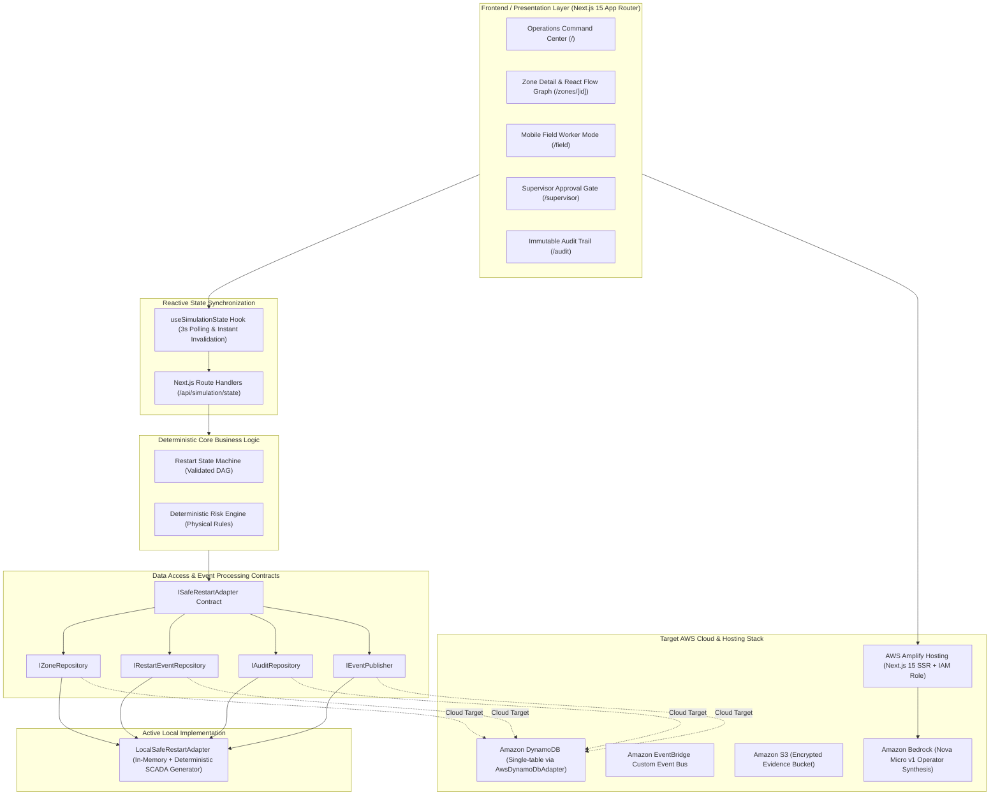
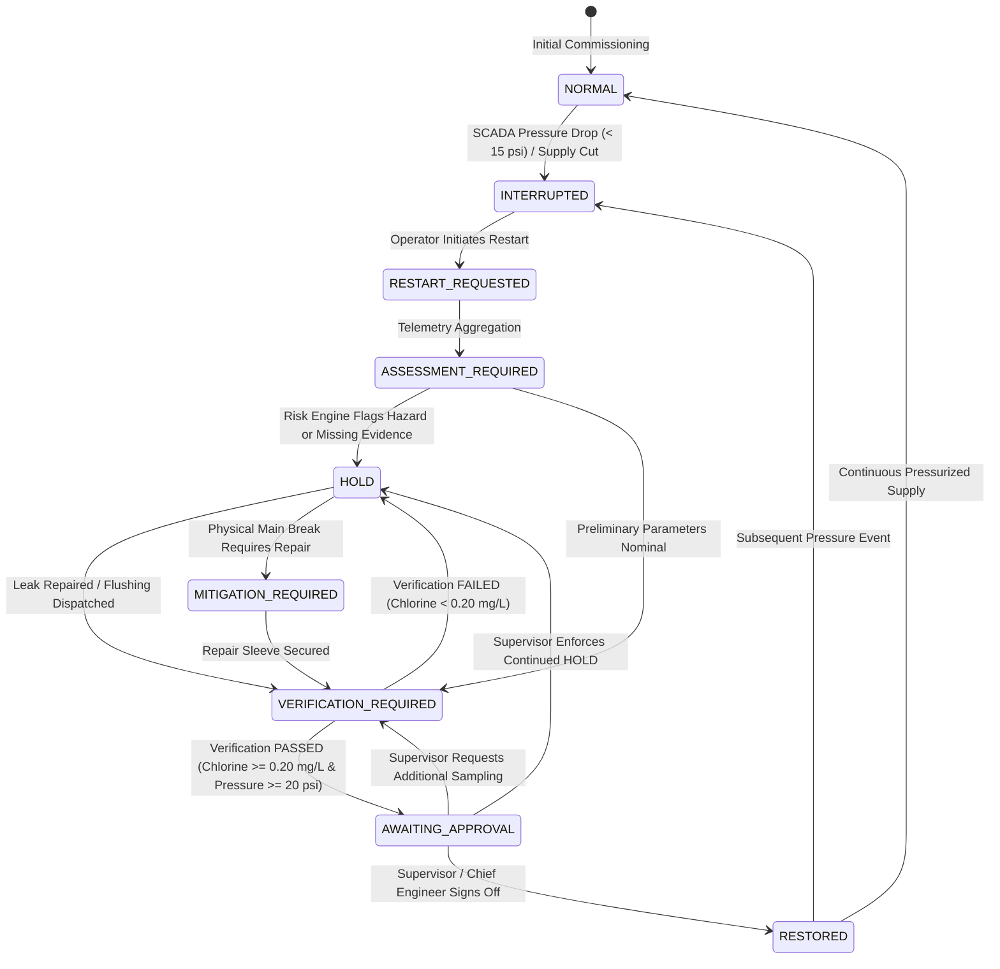

# SafeRestart — Technical Architecture & Component Specification

This document details the architectural design, domain state machine, risk heuristics, persistence abstraction, and cloud readiness of **SafeRestart**.

---

## 1. High-Level Architecture Overview

SafeRestart is structured around clean domain-driven separation of concerns:

---

## 2. Core Operational State Machine (DAG)

The restart lifecycle strictly avoids arbitrary state jumps. Every transition enforces prerequisite physical checks and attributed actor permissions:

### Transition Rule Specifications

| From State | To State | Trigger / Guard Condition | Authorized Actor Roles |
| :--- | :--- | :--- | :--- |
| `NORMAL` | `INTERRUPTED` | Observed transducer pressure falls below $15\text{ psi}$ or line isolated. | `SYSTEM_SIMULATOR`, `SUPERVISOR` |
| `INTERRUPTED` | `RESTART_REQUESTED` | Operator initiates restart evaluation. Idempotent check prevents duplicate events. | `SUPERVISOR`, `CHIEF_WATER_ENGINEER` |
| `RESTART_REQUESTED` | `ASSESSMENT_REQUIRED` | Internal telemetry and vulnerability aggregation. | `SYSTEM_SIMULATOR` (Workflow) |
| `ASSESSMENT_REQUIRED` | `HOLD` | Risk score $\ge 50$ or any critical factor (`HIGH`) or any missing evidence. | `SYSTEM_SIMULATOR` (Risk Engine) |
| `VERIFICATION_REQUIRED` | `HOLD` | Field verification test fails ($< 0.20\text{ mg/L}$ free chlorine, $< 20\text{ psi}$, or flushing incomplete). | `FIELD_TECHNICIAN`, `WATER_QUALITY_SPECIALIST` |
| `VERIFICATION_REQUIRED` | `AWAITING_APPROVAL` | Field verification passes ($\ge 0.20\text{ mg/L}$ free chlorine, $\ge 20\text{ psi}$, flushing verified, zero pending tasks). | `WATER_QUALITY_SPECIALIST`, `FIELD_TECHNICIAN` |
| `AWAITING_APPROVAL` | `RESTORED` | Authorized supervisor signs off, verifies compliance checklist, zero missing evidence. | `SUPERVISOR`, `CHIEF_WATER_ENGINEER` |
| `AWAITING_APPROVAL` | `VERIFICATION_REQUIRED` | Supervisor requests additional secondary verification. Appends new task. | `SUPERVISOR`, `CHIEF_WATER_ENGINEER` |

---

## 3. Deterministic Risk Engine Logic

Implemented in [`src/lib/risk-engine.ts`](../src/lib/risk-engine.ts), the engine calculates an illustrative vulnerability score ($0 - 100$) and explicit contributing factors:

### Evaluated Dimensions:
1. **Interruption Duration**:
   - $\ge 12.0\text{ hours}$: `HIGH` severity (+35 pts). Biofilm sloughing and pipe sediment mobilization.
   - $\ge 4.0\text{ hours}$: `MEDIUM` severity (+20 pts). Water stagnation and low-pressure ingress hazard.
   - $< 4.0\text{ hours}$: `LOW` severity (+5 pts).
2. **Minimum Observed Hydraulic Pressure**:
   - $\le 5.0\text{ psi}$: `HIGH` severity (+40 pts). Critical negative pressure aspiration hazard.
   - $< 15.0\text{ psi}$: `MEDIUM` severity (+20 pts). Sub-nominal operating pressure.
   - $\ge 15.0\text{ psi}$: `LOW` severity.
3. **Telemetry Freshness**:
   - Age $> 30\text{ minutes}$ or `isStale = true`: `HIGH` severity (+25 pts). Flags missing `fresh_scada_telemetry`.
4. **Physical Pipe Breach**:
   - Unresolved active collar crack or main shear: `HIGH` severity (+30 pts). Flags missing `leak_isolation_and_repair_verification`.
5. **Free Chlorine Disinfection Residual**:
   - Missing or $< 0.20\text{ mg/L}$: `HIGH` severity (+30 pts). Flags missing `free_chlorine_residual_measurement`.
   - $0.20 - 0.49\text{ mg/L}$: `MEDIUM` severity (+10 pts). Marginally compliant.
   - $\ge 0.50\text{ mg/L}$: `LOW` severity. Disinfection residual confirmed.

**Core Safety Invariant**: Missing evidence is never treated as passing. Any `HIGH` severity factor or missing evidence automatically triggers `action = 'HOLD'`.

---

## 4. Storage & Event Abstraction Architecture

To ensure zero lock-in and allow development without active cloud credentials, persistence is isolated behind formal TypeScript contracts in [`src/lib/contracts/interfaces.ts`](../src/lib/contracts/interfaces.ts):

- `IZoneRepository`: Abstract queries for distribution zones, topology nodes, and pipe segments.
- `IRestartEventRepository`: Abstract queries for restart events and field task lifecycle.
- `IAuditRepository`: Abstract append-only audit trail repository.
- `IEventPublisher`: Abstract event bus interface (`publish(event)`).
- `ISafeRestartAdapter`: High-level provider interface.

### Active Local Implementation:
[`LocalSafeRestartAdapter`](../src/lib/adapters/local-store-adapter.ts) executes 100% in-process. All business logic in `store.ts`, `state-machine.ts`, and `risk-engine.ts` communicates exclusively through these contracts.

### AWS Cloud Implementation:
An [`AwsDynamoDbAdapter`](../src/lib/adapters/dynamodb-adapter.ts) is implemented and ready for cloud deployment:
- `IZoneRepository` $\rightarrow$ Amazon DynamoDB `saferestart-zones-dev`
- `IRestartEventRepository` $\rightarrow$ Amazon DynamoDB `saferestart-events-dev` (GSI on `zoneId`)
- `IAuditRepository` $\rightarrow$ Amazon DynamoDB `saferestart-audit-dev` (GSI on `zoneId` + `timestamp`)
- `IEventPublisher` $\rightarrow$ Amazon EventBridge `saferestart-bus-dev`
- Field photo evidence $\rightarrow$ Amazon S3 `saferestart-evidence-...`
- Complete IaC specification in [`template.yaml`](../template.yaml)
